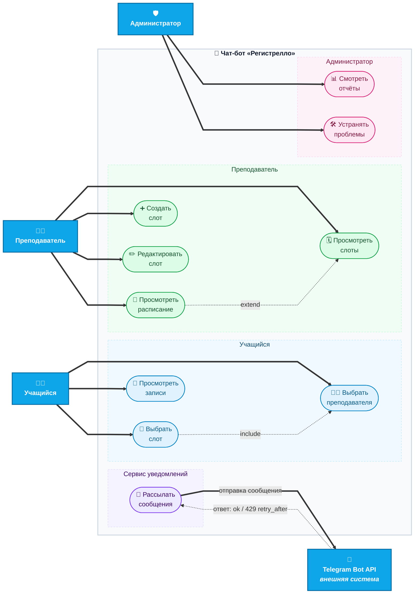

---
tags:
  - тз
  - тз/контент
status: draft
version: 0.1
updated: 2026-09-23
---
# Границы системы

В разработку бота входит интерфейс работы преподавателя (репетитора), интерфейс учащегося, панель администрирования системы. Напоминания и оповещения о событиях для всех связанных участников.
В разработку не входят: веб-интерфейс для дополнительных функций, кроме админки, в т. ч. для создания слотов.

- [ ] Зафиксировать ограничения среды (хостинг, лимиты Telegram API, МСК)

## Диаграмма границ системы:

## Связанные разделы
- [[04. Системные требования]]
- [[05. Критерии приёмки]]
