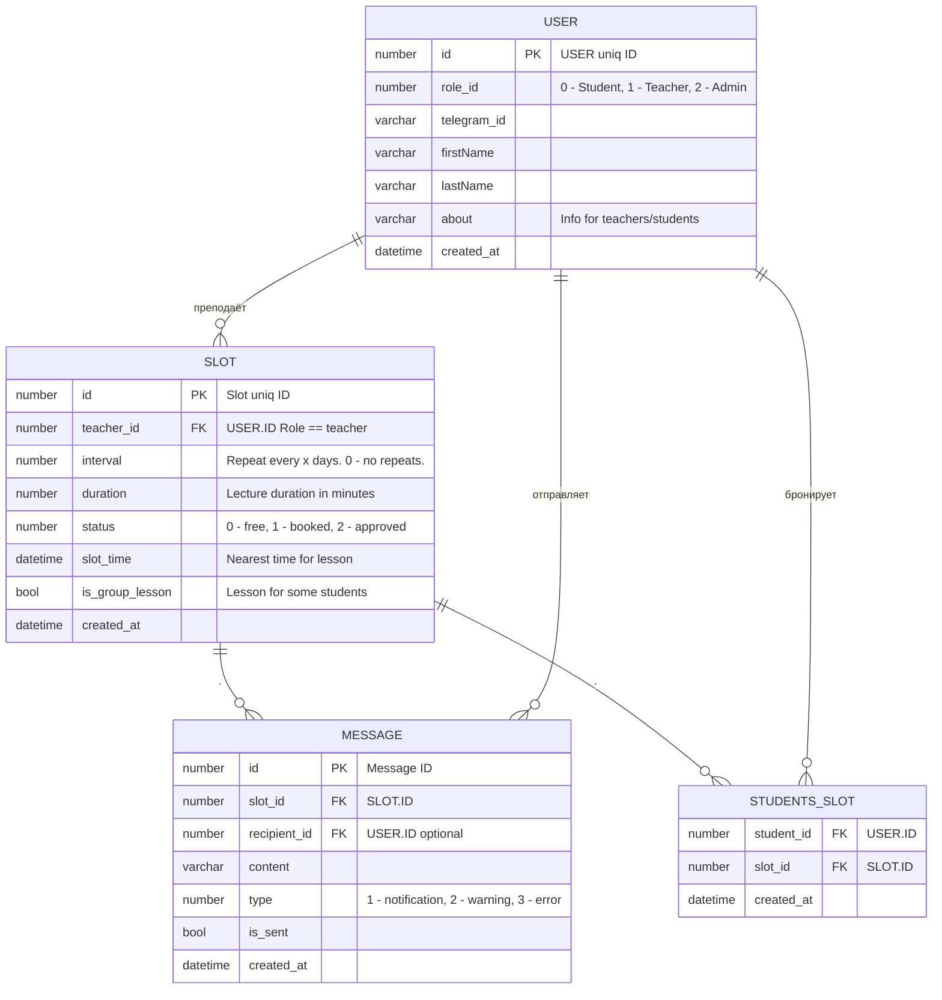

---
tags:
  - тз
  - тз/контент
status: draft
version: 0.1
updated: 2026-09-23
---
# Назначение
## Функции системы

1. Регистрация пользователя. Пользователь может зарегистрироваться как "Преподаватель" указав своё имя или как учащийся перейдя по кнопке `<Start>` чат-бота.
2. Зайдя как "Преподаватель" пользователь может выбрать удобное для проведения занятий время. Просмотреть список своих слотов. Отредактировать или выборочно удалить. Может подтвердить или отказать назначению занятия для определённого пользователя в определённое время.
3. Зайдя как "Учащийся" пользователь может просмотреть список преподавателей с которыми в недавнем времени были занятия, выбрать свободный слот у определённого преподавателя и записаться на обучение. Также пользователь может ознакомиться со списком своих назначений и, при необходимости, скорректировать его.
4. Система рассылает сообщения пользователям во всех операциях, где затрагивается связанный пользователь. Например, пользователь с ролью "Учащийся" решает отказаться от ранее подтверждённого занятия. Преподавателю приходит соответствующее сообщение, что указанный слот освободился. Или преподаватель решает отредактировать слот, сообщение об изменении времени приходит учащемуся.
5. Администратор следит за системными логами и отчётами, в случае неполадок или жалоб пользователей предпринимает действия к устранению затруднений.

## Формат данных

## Связанные разделы
- [[01. Описание системы]]
- [[02. Границы системы]]